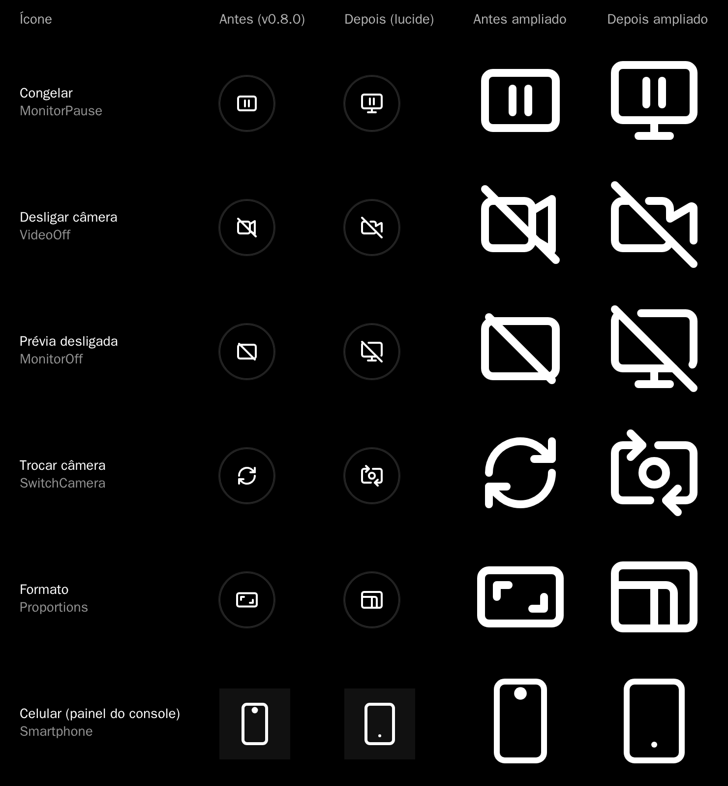

# Relatório v0.9.0, sessão web

Spec: `docs/specs/spec-v0.9.0.md` · Handoff: `docs/handoff-v0.9.0.md` · Branch: `feature/video-web` (worktree `.worktrees/web-video`) · Design: `docs/design-v0.9.0.md`

## 1. Área Vídeo (spec §2)

- Painel "Vídeo" (`console/video-panel.tsx`) no mesmo sistema dos painéis da v0.8.0. Aguardando: na coluna do QR, abaixo de "QR code novo". Ao vivo com o celular: na coluna lateral. Ele permite escolher ou arrastar o arquivo (o painel clareia para `--raised` enquanto o arquivo está por cima), mostra a barra e a porcentagem do envio, o nome e a duração, e tem Usar vídeo, Trocar vídeo e Remover vídeo. Resolução, fps e codec do vídeo aparecem só em Detalhes, no lugar dos dados do celular, enquanto o vídeo está ativo.
- Envio com `XMLHttpRequest` em `media/video-upload.ts`: `PUT` com corpo bruto, `Content-Type: application/octet-stream` e `X-File-Name` com `encodeURIComponent`. O progresso vem de `upload.progress`, e os erros saem como `ApiError` pelo `code`. As ações ficam em `data/use-video-source.ts`; os novos clientes de API (`changeVideoSource`, `removeVideoFile`, `seekVideo`) ficam em `data/api-client.ts`.
- Vídeo ativo: `console/video-view.tsx` toma o lugar do QR e da área do celular. A pílula mostra "Vídeo em repetição" com um triângulo de reprodução em `--data-2`, a mesma forma do sexto estado da bandeja. O painel avisa que a câmera mostra o vídeo, não o celular. A prévia (ADR 0015) mostra o vídeo, e a fileira de controles fica com Congelar, Espelhar, Prévia e Voltar ao celular (no lugar de Desconectar). Desligar câmera e Trocar câmera somem, porque exigem o celular.
- `consoleMode` (`data/console-view.ts`) ganhou o modo `video`. Com o vídeo ativo e Congelar ligado, o modo é `frozen`, com o aviso e o Descongelar da v0.8.0.
- Erros `video_too_large`, `video_unsupported`, `no_video_file`, `video_source_active` e `video_source_inactive` usam as chaves `errors.*` que já estavam na integração. Os erros do envio e das ações do vídeo aparecem dentro do painel; o `409` do QR aparece no alerta do topo, como os outros.
- `/cam`: o encerramento `video_source` mostra `cam.ended_video_source` sem a marca de falha, como "o computador encerrou" (`data/cam-state.ts`, `cam/cam-messages.ts`).

## 2. Linha do tempo (spec §2.1)

- `console/video-timeline.tsx`, sob a prévia: "0:03 de 0:06" e a barra. Clicar ou arrastar pede `PUT /api/video-source/position` só ao soltar. Pelo teclado, as setas pulam 5 s e Home volta ao começo. Ela é um `role="slider"` com o rótulo `console.video_timeline` e `aria-valuetext` igual ao texto visível.
- A regra de posição fica em `data/video-position.ts`, um módulo puro com Vitest: entre os eventos do SSE a posição avança pelo relógio local enquanto o vídeo roda, é corrigida pelo valor do agente a cada evento, para com Congelar e volta ao começo no fim do vídeo. Depois de um pulo, a barra fica no ponto escolhido até chegar o próximo valor do agente.
- A barra anda a cada quadro só com `transform` (`media/use-frame-loop.ts`, `requestAnimationFrame`). O React só renderiza quando o segundo mostrado muda.

## 3. Bibliotecas (spec §2.2) e CA 9

### Procedimento

O mesmo antes e depois:
- Chromium headless (Playwright 1.64.1) no compose, sem portas no host (projeto próprio, `ports: !reset []`).
- Celular falso ao vivo (câmera falsa do Chromium, 1080p30). O `/dev` abre numa instância separada do navegador, em 1440 × 900, com a janela de 120 s.
- 2 min para encher a janela e mais 2 min medidos, contando a thread principal da página (CDP `Performance.getMetrics`, `TaskDuration`) e o `cpuTime` do processo do renderizador do `/dev` (`SystemInfo.getProcessInfo`).
- Mesmo agente nos dois lados (`feature/video-agent` 8c2fc19). Base = web antes das bibliotecas (d2272ed); depois = web com uPlot e lucide (279e3cf). As rodadas foram intercaladas.
- Duas condições: prévia ligada, como pede a spec, e prévia bloqueada, que isola o custo dos gráficos (a prévia de vídeo domina o processo).
- Tamanho: build de produção com manifesto, gzip nível 9 da entrada mais o pedaço da página e os pedaços que ela importa.

### CPU do navegador com o `/dev` aberto (janela cheia, 2 min medidos)

| Condição | Medida | SVG (base) | uPlot | Resultado |
| --- | --- | --- | --- | --- |
| Prévia ligada | Thread principal | 1,24% | 1,69% | pior |
| Prévia ligada | Processo do renderizador | 9,97% | 15,14% | pior |
| Prévia ligada | Processo da GPU | 3,51% | 6,50% | pior |
| Prévia bloqueada | Thread principal | 1,22% | 1,33% | igual ou pior |
| Prévia bloqueada | Processo do renderizador | 2,27% | 2,53% | igual ou pior |
| Prévia bloqueada | Processo da GPU | 0,32% | 0,65% | pior |

Para referência, a mesma medição com a web e o agente da v0.8.0 (bf766b0) deu 1,31% na thread principal e 11,4% no renderizador com a prévia, e 1,15% e 2,17% sem ela. Os 2 min de enchimento seguem a mesma tendência (base 1,04% e uPlot 2,37% na thread principal com a prévia).

### Tamanho do JS (gzip)

| Página | v0.8.0 | v0.9.0 sem bibliotecas | Com uPlot e lucide | Entregue (só lucide) |
| --- | --- | --- | --- | --- |
| `/` | 86,4 KB | 88,9 KB | 90,2 KB | 90,2 KB |
| `/dev` | 84,1 KB | 84,2 KB | 106,7 KB | 84,2 KB |
| `/cam` | 87,6 KB | 87,7 KB | 89,3 KB | 89,3 KB |

### Decisão

- **uPlot não entra.** Ele não reduziu a CPU nas duas condições e acrescentou 22,5 KB ao `/dev`. Os gráficos em SVG já custavam perto de 1% da thread principal, e o redesenho em canvas trouxe mais trabalho de GPU. A versão em uPlot (mesmo estilo da v0.8.0, com o canvas sem eixos, legenda, cursor, tooltip ou animação da biblioteca) foi revertida e a dependência saiu. O `/dev` continua com os gráficos da v0.8.0, sem mudança visual, e por isso não há captura de gráficos antes e depois.
- **lucide-react fica** (decisão do orquestrador em 2026-11-15): a troca de ícones foi pedido do usuário, não toca o `/dev` (lá não há ícone, então não há CPU para medir) e aumenta o JS da `/` em 1,3 KB, abaixo do limite de 15 KB. Cada ícone é importado pelo nome, e o build leva só os seis usados.

### Ícones trocados

`docs/capturas/v0.9.0-icones-antes-depois.png`: cada ícone no tamanho real (botão de 56 px do celular; 48 px no painel do console) e ampliado. Congelar `MonitorPause`, Desligar câmera `VideoOff`, Prévia desligada `MonitorOff`, Trocar câmera `SwitchCamera`, Formato `Proportions`, Celular `Smartphone`. O desenho do lucide difere do anterior: Congelar e Prévia desligada ganharam o pé de monitor, Trocar câmera ganhou o corpo da câmera, Formato virou uma divisão de proporção, e o celular do painel perdeu a lente que mudava de lugar conforme a câmera (a câmera em uso continua escrita abaixo do nome). Falta o usuário conferir (CA 8).

## 4. Testes

- Vitest: 176 testes. Novos: `media/video-upload.test.ts` (7: corpo bruto e nome codificado, progresso, sucesso, `video_too_large`, `video_unsupported`, rede, abortar), `data/video-position.test.ts` (9: avanço pelo relógio, correção pelo agente, parada com Congelar, volta ao começo, limites e passo de 5 s, relógio), `console-view.test.ts` (modo e pílula do vídeo) e `cam-state.test.ts` (encerramento `video_source`).
- e2e `video-source.spec.ts`. Ele envia `E2E_TEST_VIDEO` pelo input do console e confere os metadados (1280 × 720, h264, 6 s). Depois clica Usar vídeo e confere a pílula, `virtualCamera.source` `video`, o QR fora da tela, a prévia com imagem e `POST /api/pairing` com `409`. Em seguida congela, arrasta a linha do tempo para longe da posição congelada e confere `positionSeconds` no ponto escolhido (0,5 s de tolerância), descongela, clica Voltar ao celular e confere a pílula Aguardando, a fonte diferente de `video` e o QR de volta. O `beforeAll` e o `afterAll` desativam e apagam o vídeo.
- e2e completo no estado final da branch (com `origin/feature/video` a43f781), no compose sem portas no host: **33 de 33 passaram**, incluindo o SSIM do CA-2 com o vídeo desativado: 0,9853 (mínimo 0,9832, 31 quadros).

## 5. Critérios de aceitação que a sessão web toca

| CA | Situação |
| --- | --- |
| 3 Linha do tempo | Posição andando, pulo por clique, arraste e teclado, parada com Congelar: implementados; arraste e congelamento verificados no e2e. Mudança no Meet em até 1 s: não verificado (depende do Windows e do Meet) |
| 4 Ativar e desativar | Console troca para "Vídeo em repetição" e volta ao QR (e2e). O celular mostra a mensagem própria do encerramento. A bandeja e os 300 ms com o app real não foram verificados por esta sessão |
| 5 Arquivo que não é vídeo | Texto próprio no painel ("Este arquivo não é um vídeo que o WCam consiga abrir."), visto na captura renderizada; apagar do disco é do agente |
| 7 CA-2 | SSIM 0,9853 no e2e com o vídeo desativado |
| 8 Bibliotecas | uPlot não entrou (CA 9). Ícones em lucide: falta a conferência do usuário |
| 9 Medição | Tabelas acima |
| 10 Verificação | `npm run build` sem avisos, `npm run lint`, `npm test` e `npm run test:e2e` limpos; `version` 0.9.0 em `web/package.json` |

## 6. Textos

Nenhuma chave nova nem alterada: o web usa só as chaves `console.video_*`, `cam.ended_video_source`, `state.video`, `controls.use_video`, `controls.back_to_phone` e `errors.*` que o orquestrador pôs na integração.

## 7. Não verificado

- O fluxo real fora do Docker (`uv run wcam`, câmera virtual nos apps do CA-1 e no Meet): o WCam 0.8 do usuário ocupa as portas 8080 e 8443, e a regra é não subir o agente nelas sem combinar.
- O visual foi conferido por esta sessão em capturas renderizadas do Chromium do compose (console Aguardando com e sem vídeo, Vídeo em repetição em 1440 e 390 px, foco na linha do tempo, congelado, erro de arquivo). Não foi visto pelo usuário nem no navegador dele.
- Arrastar um arquivo do sistema para o painel não está no e2e, que usa o input de arquivo.
- Vídeo em pé, 4K HEVC e CPU do CA 6 são do relatório do agent.
